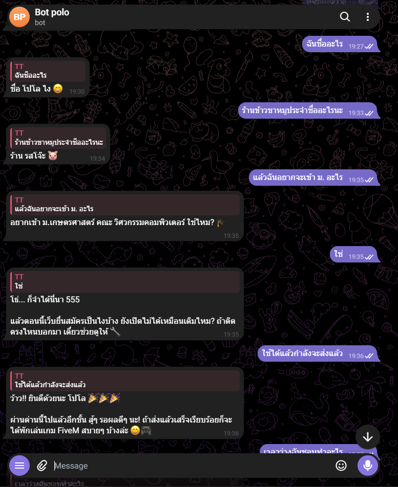
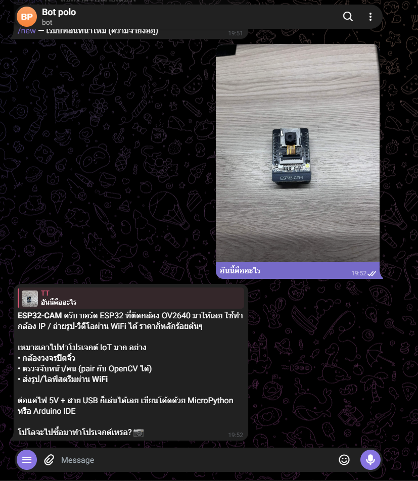
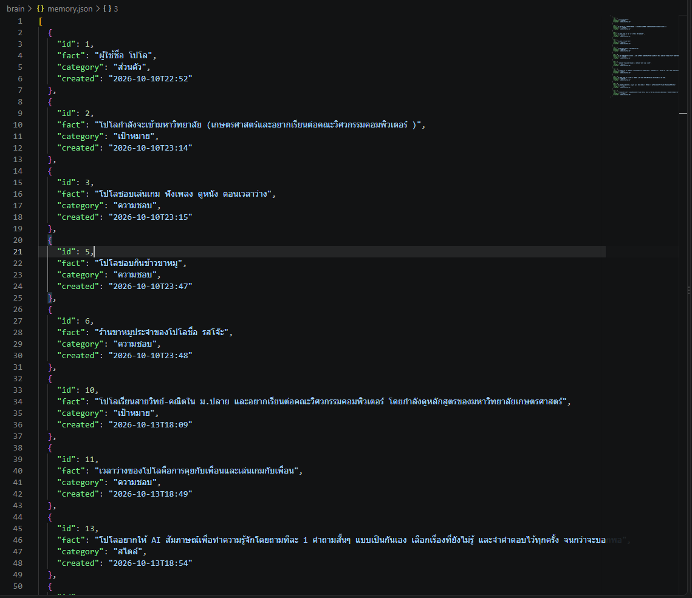

# AI ส่วนตัวที่จำเรื่องของเราได้

AI ที่คุยผ่าน Telegram แล้วจำเรื่องที่เคยคุยได้ แชตบอตทั่วไปเปิดแชตใหม่ทีไรก็ลืมหมด ตัวนี้เก็บความจำเป็น file ไว้ในเครื่อง บอกอะไรไปแล้วมันจำได้ จดโน้ตให้ได้ ส่งรูปให้ดูได้ และค่อยๆ ปรับวิธีตอบให้เข้ากับคนที่คุยด้วย

ทำโดย โปสรินท์ สุขดี (โปโล) ม.6 โรงเรียนอยุธยาวิทยาลัย

## ทำอะไรได้บ้าง

- **จำเรื่องสำคัญ** พิมพ์ว่า "จำไว้นะ..." AI จะเรียก function บันทึกลงความจำเอง (tool calling) ถ้าข้อมูลเก่าผิดก็ลบแล้วจำใหม่
- **ค้นหาความจำและโน้ต** ภาษาไทยไม่เว้นวรรค ตัดคำยาก เลยใช้วิธีเทียบทีละ 3 ตัวอักษร (n-gram)
- **เรียนรู้ผู้ใช้** คุยครบ 8 ข้อความ AI จะย้อนอ่าน chat แล้วสรุปใหม่ว่าผู้ใช้เป็นคนแบบไหน เก็บไว้ที่ `brain/user.md`
- **ตอบแบบ stream** รับคำตอบมาทีละท่อนแล้วทยอยแก้ข้อความใน Telegram เพราะรอนานๆ แล้วโดน Cloudflare ตัดการเชื่อมต่อ

## ตอนใช้งานจริง

| จำเรื่องที่เคยคุย | ส่งรูปให้ดู | ความจำที่ AI บันทึกเอง |
|---|---|---|
|  |  |  |

## ไฟล์

| ไฟล์ | หน้าที่ |
|---|---|
| `ai.py` | สมองของ AI: ความจำ, ค้นหา, เครื่องมือที่ AI เรียกได้, เชื่อมต่อ LLM, สรุปตัวตนผู้ใช้ |
| `telegram_bot.py` | ตัวบอต Telegram: รับข้อความ/รูป, คำสั่ง `/mem` `/profile` `/learn` ฯลฯ |
| `brain/profile.md` | นิสัยของ AI (แก้ได้) |
| `bot_loop.bat`, `run_hidden.vbs` | รันบอตเบื้องหลัง ถ้าล่มจะเปิดใหม่เอง |

## วิธีรัน

1. ใช้ Python 3.11 ขึ้นไป (ใช้แค่ library มาตรฐาน ไม่ต้องลงอะไรเพิ่ม)
2. คัดลอก `.env.example` เป็น `.env` แล้วใส่ API key ของ LLM กับ Telegram bot token
3. รัน `python telegram_bot.py`

ความจำและประวัติแชตจริงไม่ได้อัปขึ้นมา เพราะเป็นข้อมูลส่วนตัว
